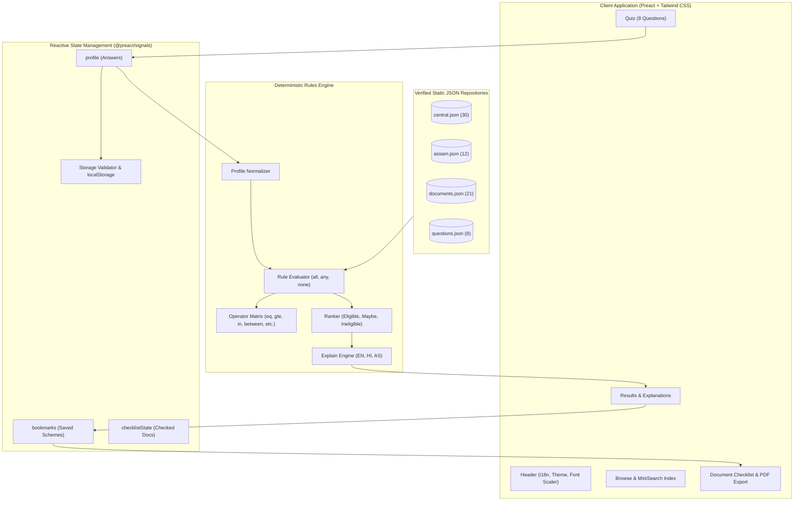

# SchemeSetu (স্কিমসেতু / स्कीमसेतु)

<p align="center">
  <strong>Civic Welfare Discovery & Eligibility Engine for Indian Citizens</strong><br>
  <em>100% Client-Side • Zero Data Tracking • Indic Multilingual • Offline-Ready PWA</em>
</p>

<p align="center">
  
  
  
  
  
  
  
  
</p>

---

## 📖 Overview

**SchemeSetu** is an open-source, mobile-first civic technology platform designed to bridge the gap between Indian citizens and government welfare entitlements.

In India, hundreds of Central and State government welfare schemes exist to support farmers, students, women, senior citizens, artisans, low-income families, and persons with disabilities. However, millions of eligible citizens miss out on life-changing benefits due to:
- Fragmented, opaque government websites and portals.
- Complex and confusing eligibility criteria.
- Language barriers (technical bureaucratic English or Hindi).
- Privacy fears regarding sensitive biometric and financial data leaks.
- Intermittent mobile connectivity in rural and semi-urban areas.

**SchemeSetu solves this completely:** A citizen answers an 8-question, 60-second survey and instantly receives a transparent, explainable list of schemes they qualify for, along with a unified, deduplicated document checklist and verified application links—**with no login, zero tracking, and zero personal data ever leaving the device.**

---

## ✨ Key Features

### ⚡ 1. Smart 60-Second Eligibility Engine
- **8 Simple Questionnaire Items**: State/UT, Area (Rural/Urban), Age, Gender, Annual Family Income, Social Category (General/OBC/SC/ST/EWS), Primary Occupation, and Special Status (BPL, Disability, Widow, Minority, Girl Child, Land Owner, Street Vendor).
- **Instant Result Partitioning**: Schemes are deterministically grouped into:
  - 🟢 **Eligible**: All criteria match with high confidence.
  - 🟡 **Maybe Eligible**: Borderline or missing details (e.g., specific sub-categories), with clear guidance on what to verify at local offices.
  - 🔴 **Not Eligible**: Hidden by default but expandable with honest, transparent disqualification reasons.

### 🔒 2. Zero-Knowledge Privacy Architecture
- **100% Client-Side Evaluation**: All rule evaluations, score computations, and document matching execute in the browser.
- **Zero Server Storage & Zero Telemetry**: No backend server is required. No Aadhaar numbers, phone numbers, names, or income records are collected or transmitted.
- **Hardened Local Persistence**: Bookmarks and profile state are isolated under `schemesetu_*` in `localStorage`, guarded by strict type and boundary schema validators.
- **1-Click Privacy Purge**: A dedicated "Clear My Saved Data" control on the About page instantly wipes all local application storage.

### 🌐 3. Full Indic Multilingual Support
- First-class support for **English**, **অসমীয়া (Assamese)**, and **हिन्दी (Hindi)**.
- Every scheme title, benefit summary, rule explanation, document procurement step, and questionnaire option is localized.
- Seamless one-click language toggle across the header and navigation.

### 📱 4. Offline-Ready Progressive Web App (PWA)
- Installable on Android, iOS, Windows, macOS, and Linux as a standalone web app.
- All 42 welfare schemes, 21 master document procurement guides, and the entire evaluation engine are bundled client-side—allowing full functionality without an active internet connection.

### 🗂️ 5. Master Document Checklist & PDF Export
- Aggregates required documentation across all matched or bookmarked schemes.
- Deduplicates prerequisites into a single, actionable checklist (e.g., *"Collect these 5 documents to apply for 8 schemes"*).
- Includes step-by-step guidance on how and where to procure each document (CSC centers, UIDAI, state revenue offices, etc.).
- **Print & PDF Generator**: Built-in sanitized HTML printable view for offline printing or saving as PDF for CSC operators and village volunteers.

### 🔍 6. Fuzzy Client-Side Search & Multi-Faceted Filters
- Powered by **MiniSearch** for instant, typo-tolerant full-text search across titles, summaries, tags, and ministries.
- Dynamic filtering by **Jurisdiction** (Central vs. State), **Sector/Category** (Agriculture, Healthcare, Education, Housing, Social Security, Women & Child, Entrepreneurship), and **Beneficiary Window**.

### ♿ 7. Inclusive Accessibility & Civic UI (WCAG 2.1 AA)
- **Dynamic Font Scaling**: 3-level font scaler (`A-`, `A`, `A+`) preserving layout integrity.
- **High-Contrast Civic Theme**: Tailored color contrast overrides ensuring readability under direct sunlight and on low-cost mobile displays.
- **Voice Navigation (Web Speech API)**: Interactive speech recognition for voice search and text-to-speech read-aloud support.
- **Full Keyboard Navigation**: Focus indicators and screen-reader accessible ARIA tags throughout.

---

## 🏛️ Verified Civic Datasets (42 Schemes)

SchemeSetu ships with vetted, production-grade scheme definitions sourced directly from official Central and State gazettes:

### Central Government Schemes (30 Schemes)
| Scheme | Sector / Ministry | Target Beneficiaries |
|---|---|---|
| **PM-KISAN** | Agriculture & Farmers Welfare | Small & marginal landholding farmers |
| **Ayushman Bharat (PM-JAY)** | Health & Family Welfare | Bottom 40% vulnerable families (₹5 Lakh cover) |
| **PM Awas Yojana (Gramin)** | Rural Development | Rural homeless & kutcha house dwellers |
| **PM Awas Yojana (Urban)** | Housing & Urban Affairs | Urban EWS / LIG / MIG families |
| **PM Ujjwala Yojana (PMUY)** | Petroleum & Natural Gas | Adult women from BPL / SC / ST households |
| **Sukanya Samriddhi Yojana** | Finance / Women & Child | Girl child under 10 years |
| **PM Mudra Yojana (PMMY)** | Finance | Micro-entrepreneurs & non-farm enterprises |
| **PM SVANidhi** | Housing & Urban Affairs | Urban street vendors and hawkers |
| **PM Vishwakarma** | Micro, Small & Medium Enterprises | Traditional artisans & craftspeople (18 trades) |
| **Atal Pension Yojana (APY)** | Finance (PFRDA) | Unorganized sector workers (18–40 years) |
| **PM Jeevan Jyoti Bima (PMJJBY)** | Finance | Citizens aged 18–50 with savings bank accounts |
| **PM Suraksha Bima (PMSBY)** | Finance | Citizens aged 18–70 (Accidental death/disability) |
| **PM Matru Vandana (PMMVY)** | Women & Child Development | Pregnant women & lactating mothers |
| **National Social Assistance (NSAP)** | Rural Development | Elderly (60+), widows, & persons with severe disabilities |
| *...and 16 more Central Schemes* | *Education, Skills, Social Justice, Agriculture* | *Students, youth, minorities, and farmers* |

### Assam State Schemes (12 Schemes)
| Scheme | Department | Target Beneficiaries |
|---|---|---|
| **Orunodoi 2.0** | Finance Department, Assam | Underprivileged women (₹1,250/month DBT) |
| **Mukhya Mantri Mahila Udyamita** | Panchayat & Rural Development | Rural women SHG members for micro-business |
| **Pragyan Bharati Scooty Scheme** | Higher Education, Assam | Meritorious female students (Higher Secondary) |
| **Arundhati Gold Scheme** | Revenue & Disaster Management | Newly married brides from low-income families |
| **Abhinandan Education Loan Subsidy** | Higher Education, Assam | Students pursuing higher education (₹50,000 subsidy) |
| **Assam Swanirbhar Naari** | Handloom & Textiles | Indigenous female weavers of Assam |
| **Mukhya Mantri Atmanirbhar Asom** | Industries & Commerce | Unemployed youth seeking self-employment |
| *...and 5 more Assam Schemes* | *Health, Social Justice, Agriculture* | *Widows, senior citizens, farmers, and students* |

---

## 🏗️ Technical Architecture



### Technology Stack
- **Framework**: [Preact](https://preactjs.com/) 10 (Ultra-lightweight React alternative, < 4 KB footprint)
- **Reactivity**: `@preact/signals` (Fine-grained reactive primitives)
- **Build System**: [Vite](https://vitejs.dev/) 5 (Fast ESM development & optimized asset bundling)
- **Styling**: [Tailwind CSS](https://tailwindcss.com/) 3 (Utility-first styling with civic high-contrast modes)
- **Search Engine**: [MiniSearch](https://github.com/lucaong/minisearch) (In-memory fuzzy indexing and typo tolerance)
- **Security & Quality**: Custom verification test runners for schema staleness and XSS/link hardening

---

## 📂 Project Directory Structure

```text
SchemeSetu/
├── public/                       # Static public assets & security descriptors
│   ├── .well-known/security.txt  # Security vulnerability reporting metadata
│   ├── favicon.svg               # Vector civic glyph favicon
│   ├── manifest.webmanifest      # Progressive Web App (PWA) manifest
│   └── robots.txt                # Search engine crawler policies
├── scripts/                      # Automated auditing & verification test suites
│   ├── audit-security.js         # Automated XSS, protocol, and storage security suite
│   └── validate-data.js          # Dataset integrity, staleness, and URL auditor
├── src/
│   ├── components/               # Reusable UI & presentation components
│   │   ├── CategoryGrid.jsx      # Sector discovery cards with localized labels
│   │   ├── DocumentChecklist.jsx # Master document checklist with toggleable state
│   │   ├── Filters.jsx           # Category, jurisdiction, and criteria filters
│   │   ├── Footer.jsx            # Civic footer with disclaimers and navigation
│   │   ├── Header.jsx            # Tricolor banner, font scaler, dark mode, i18n
│   │   ├── ProgressBar.jsx       # Step-by-step quiz progress meter
│   │   ├── QuestionCard.jsx      # Accessible questionnaire card with speech input
│   │   ├── SchemeCard.jsx        # Scheme card with match score and benefit tags
│   │   ├── SchemeDetail.jsx      # Detailed scheme view with verified dual portals
│   │   └── SearchBar.jsx         # Voice-enabled fuzzy search input bar
│   ├── data/                     # Git-versioned verified datasets
│   │   ├── schemes/
│   │   │   ├── assam.json        # 12 Assam State Welfare Schemes
│   │   │   └── central.json      # 30 Central Government Welfare Schemes
│   │   ├── documents.json        # 21 Master document definitions & procurement guides
│   │   └── questions.json        # 8 Canonical citizen questionnaire items
│   ├── engine/                   # Deterministic client-side evaluation engine
│   │   ├── evaluate.js           # all/any/none rule evaluator & score generator
│   │   ├── explain.js            # Transparent rule-to-text translator (EN/HI/AS)
│   │   ├── operators.js          # Pure comparison operators (eq, in, gte, between, etc.)
│   │   └── rank.js               # Partitioner (Eligible, Maybe, Not Eligible)
│   ├── i18n/                     # Indic translation dictionaries
│   │   ├── as.json               # অসমীয়া (Assamese)
│   │   ├── en.json               # English
│   │   └── hi.json               # हिन्दी (Hindi)
│   ├── pages/                    # Route views
│   │   ├── About.jsx             # Mission, security details & privacy purge
│   │   ├── Browse.jsx            # Live fuzzy search & filtered scheme catalogue
│   │   ├── DocumentChecklistPage.jsx # Consolidated master document checklist
│   │   ├── Home.jsx              # Hero landing, 3-step guide & featured schemes
│   │   ├── Quiz.jsx              # 8-question step-by-step survey flow
│   │   ├── Results.jsx           # Ranked results with transparent explanations
│   │   ├── Saved.jsx             # Offline bookmarks & combined checklist export
│   │   └── SchemeDetailPage.jsx  # Dedicated scheme deep-link route
│   ├── store/
│   │   └── profile.js            # Reactive state store via @preact/signals + storage
│   ├── utils/
│   │   ├── i18n.js               # Internationalization loader & interpolator
│   │   ├── pdf.js                # Print-ready sanitized document checklist generator
│   │   ├── search.js             # MiniSearch fuzzy client-side search index
│   │   ├── security.js           # XSS escaping, safe URL validator & storage schema
│   │   └── speech.js             # Web Speech API recognition & speech synthesis
│   ├── App.jsx                   # Client-side router & high-contrast theme coordinator
│   ├── index.css                 # Base Tailwind styles & high-contrast overrides
│   └── main.jsx                  # Application root mount
├── index.html                    # HTML5 shell with CSP & security headers
├── package.json                  # Dependencies & scripts
├── SECURITY.md                   # Formal security policy, threat model, and disclosure protocol
├── tailwind.config.js            # Tailwind CSS design system configuration
└── vite.config.js                # Vite bundler configuration & security headers
```

---

## ⚙️ Deterministic Eligibility Logic

SchemeSetu uses a rule engine that processes criteria without black-box machine learning or external API dependencies:

### 1. Rule Combinators
Schemes declare eligibility criteria using three logical combinators:
- `all`: Every rule in this array must evaluate to `true` for the citizen to qualify.
- `any`: At least one rule in this array must evaluate to `true`.
- `none`: Disqualifiers. If any rule in this array evaluates to `true`, the citizen is disqualified.

### 2. Supported Operators (`operators.js`)
| Operator | Logic | Example Use Case |
|---|---|---|
| `eq` | Strict equality (`===`) | Gender matches `"female"` |
| `neq` | Not equal (`!==`) | Occupation is not `"salaried"` |
| `gte` | Greater than or equal | Age $\ge 18$ years |
| `lte` | Less than or equal | Family income $\le ₹2,50,000$ |
| `between`| Inclusive numerical range | Age between $[18, 40]$ |
| `in` | Value exists in target set | Social category in `["sc", "st", "obc"]` |
| `nin` | Value does not exist in set | Category not in `["general"]` |
| `contains`| Array contains target value | Special attributes contains `"disability"` |

---

## 🛡️ Security & Privacy Guarantees

As documented in [SECURITY.md](SECURITY.md), SchemeSetu adheres to strict privacy and defense-in-depth principles:

1. **Zero-Knowledge Architecture**: Citizen survey responses are never transmitted over the network.
2. **Content Security Policy (CSP)**: Locked to prevent unauthorized external script execution, cross-site frame embedding, and clickjacking:
   ```http
   default-src 'self'; script-src 'self' 'unsafe-inline'; style-src 'self' 'unsafe-inline'; img-src 'self' data: https:; font-src 'self'; connect-src 'self'; object-src 'none'; base-uri 'self'; form-action 'self';
   ```
3. **XSS & Link Hardening**: Dynamic values are escaped via `escapeHtml()`; outbound portal links are validated using `sanitizeUrl()` and enforce `rel="noopener noreferrer"`.
4. **Storage Validation**: `validateStorageData()` enforces type checks, bounded ranges, and key whitelisting against local storage corruption or manipulation.
5. **Instant Privacy Purge**: Users can permanently clear all persisted application state from the client with one click.

---

## 🚀 Getting Started

### Prerequisites
- [Node.js](https://nodejs.org/) (v18.0.0 or higher recommended)
- `npm` (v9.0.0 or higher)

### Installation
```bash
# Clone the repository
git clone https://github.com/SupratimX/SchemeSetu.git

# Navigate into the project directory
cd SchemeSetu

# Install dependencies
npm install
```

### Development Server
```bash
# Start local development server with host network exposure
npm run dev
```
Open your browser and navigate to `http://localhost:5173`.

### Production Build & Preview
```bash
# Build optimized client-side bundle
npm run build

# Preview production build locally
npm run preview
```

---

## 🧪 Automated Testing & Verification

SchemeSetu includes automated audit scripts to guarantee data integrity, link health, and security standards:

```bash
# Run both dataset validation and security audit suites
npm test

# Run security audit suite exclusively
npm run audit:security

# Run dataset verification exclusively (staleness, links, and schema)
npm run audit:data
```

### Verification Checks:
- **Schema Conformity**: Validates all JSON properties against scheme definition specifications.
- **Data Freshness / Staleness**: Flags any scheme with `lastVerified` older than 180 days.
- **Link Auditing**: Verifies that official portal URLs are valid and reachable.
- **Security Mitigations**: Tests XSS entity conversion, protocol sanitizers, search query bounding, and `rel="noopener noreferrer"` enforcement.

---

## 🤝 Contributing New Schemes

Scheme data in SchemeSetu is version-controlled as structured JSON. Community contributions for new Central or State schemes are welcome!

To add a scheme:
1. Locate the appropriate file in `src/data/schemes/` (e.g., `central.json` or create `<state>.json`).
2. Add a new scheme object following the schema:
   ```json
   {
     "id": "unique-scheme-slug",
     "title": { "en": "Scheme Name", "hi": "योजना का नाम", "as": "আঁচনিৰ নাম" },
     "summary": { "en": "Plain-language summary", "hi": "...", "as": "..." },
     "level": "central",
     "state": "ALL",
     "category": "agriculture",
     "benefits": {
       "type": "cash",
       "amount": 6000,
       "frequency": "annual",
       "description": { "en": "₹6,000 per year in 3 installments", "hi": "...", "as": "..." }
     },
     "eligibility": {
       "all": [
         { "field": "occupation", "op": "eq", "value": "farmer" }
       ],
       "any": [],
       "none": []
     },
     "documents": ["aadhaar", "bank-passbook", "land-records"],
     "officialLink": "https://official-government-portal.gov.in",
     "helpline": "1800-XXX-XXXX",
     "lastVerified": "2026-11-20",
     "verifiedBy": "Contributor Name"
   }
   ```
3. Run `npm test` to ensure your additions pass the validation suite.

---

## 👨‍💻 Author & Maintainer

Developed with ❤️ by **Supratim Gogoi**.

- GitHub: [@SupratimX](https://github.com/SupratimX)
- Project: [SchemeSetu](https://github.com/SupratimX/SchemeSetu)

---

## ⚖️ Civic Disclaimer & License

> **Civic Disclaimer**: SchemeSetu is an independent civic technology platform created for educational and informational purposes. It is **not** an official government portal and does not represent any government department or authority. All scheme information and eligibility rules are curated from publicly available government gazettes and official ministry notifications. Citizens are advised to verify details with official portals or their local Common Services Centre (CSC) before applying.

